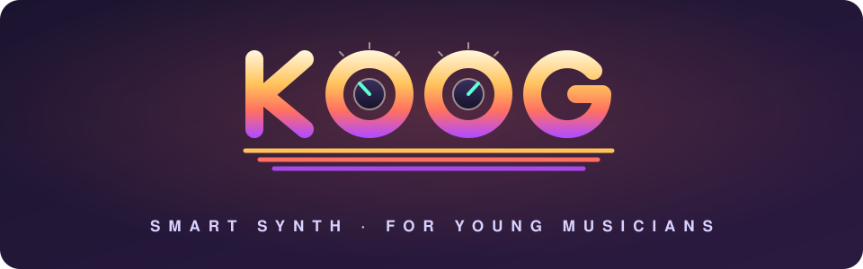
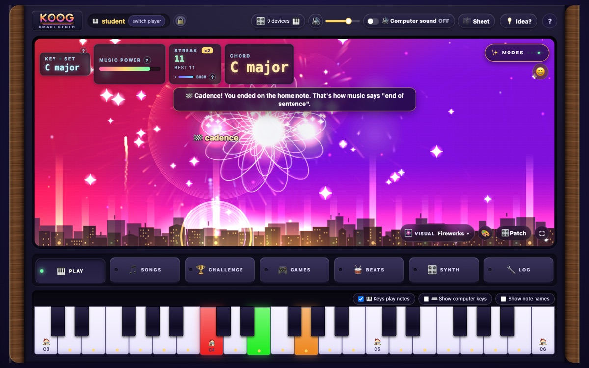
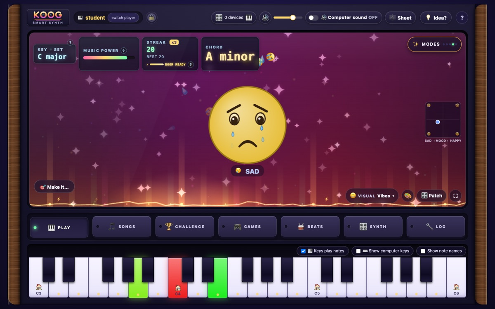
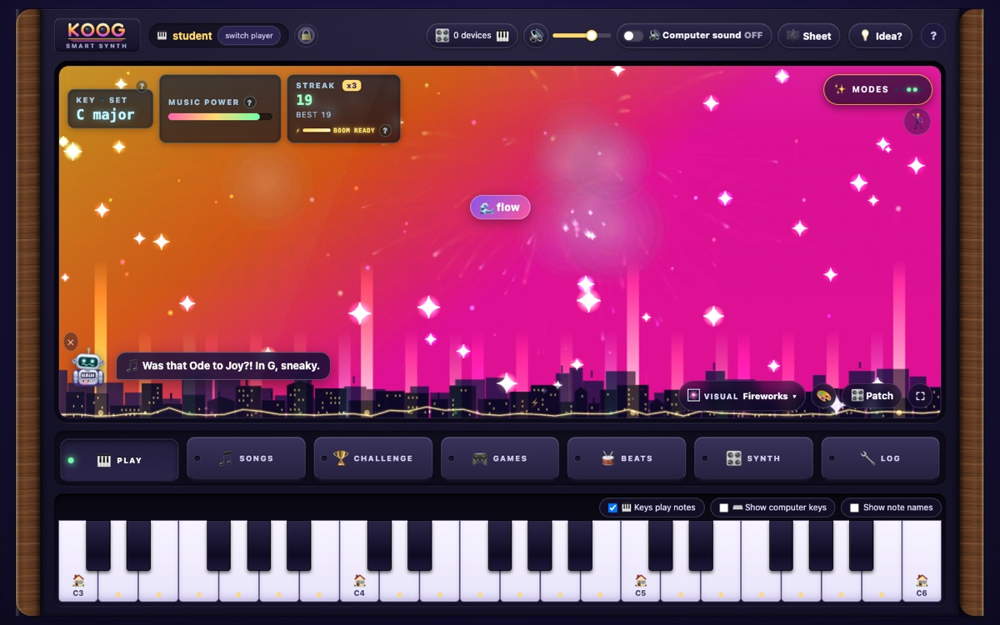
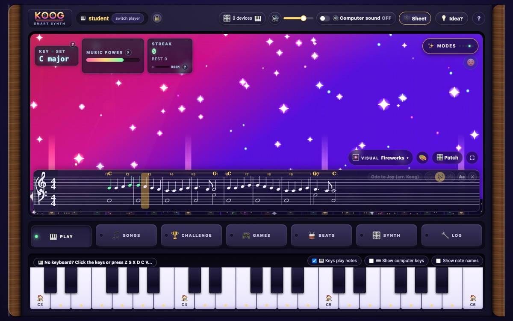
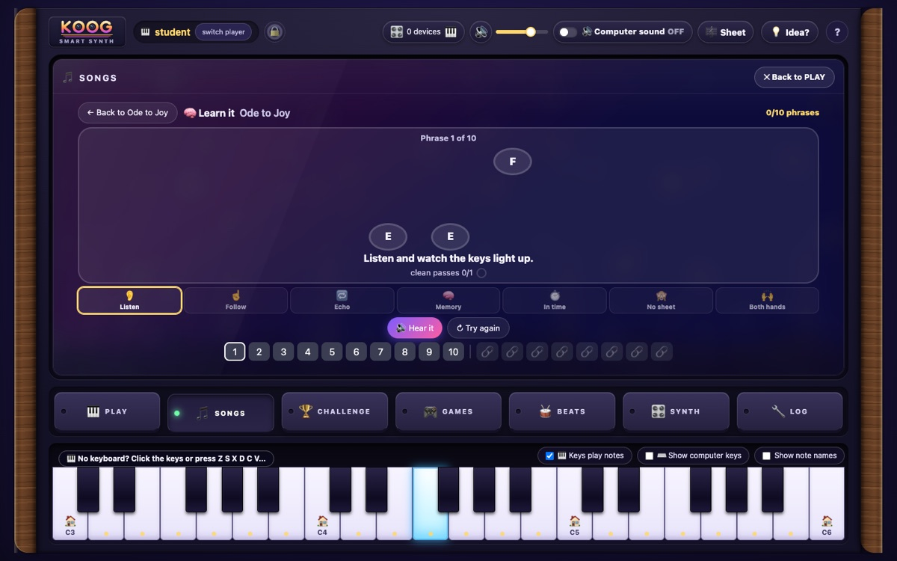
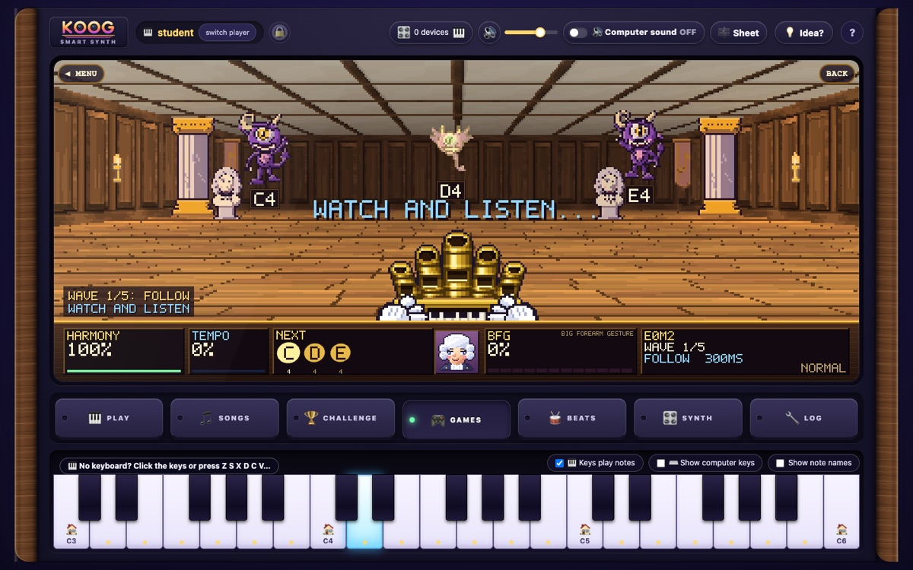
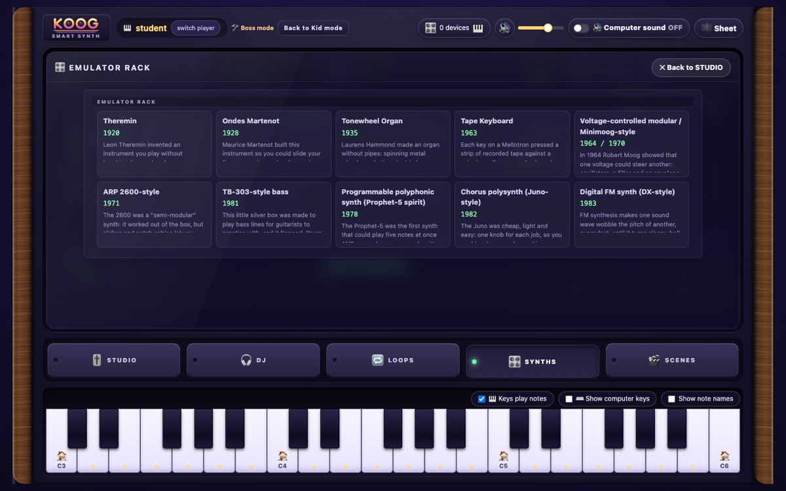
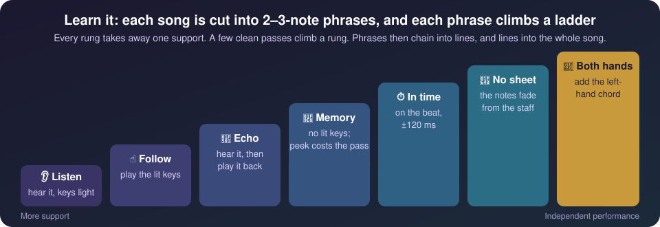

<p align="center"></p>

# Koog

> **Inspired by Moog, coded with Loog, it's... Koog!**

**Koog is a free, open-source piano and synthesizer app that listens to a child play and turns what it hears into music lessons.** When a student ends a phrase on the home note, Koog says *"Cadence!"* and the fireworks bloom. When they repeat a pattern, it says *"Motif!"* Free play becomes music literacy, and nobody has to stop and lecture.

It runs in Chrome or Edge on any computer. Plug in any USB-MIDI keyboard, or play on the computer keyboard. It has no accounts, no ads, no tracking and no cost.



---

## For teachers and parents: Koog in 60 seconds

| | |
|---|---|
| **Who it's for** | Beginners, roughly ages 6–13, at home, in a lesson, or at a station in a music lab. It also works for a child who only wants to bang on the keys. |
| **What it teaches** | Keys and scales, chords, steady pulse, phrases and cadences, motifs, tension and release, reading a grand staff, memorizing music, and some music history (synthesizers from 1920 to 1983). |
| **How** | Every note goes through one "listening judge". It names the musical idea the student just played, in kid language, and rewards it right away in the visuals and games. |
| **What it asks of you** | Nothing to install for students. A grown-up runs one command on a computer and opens a browser tab. Progress is saved per student on that computer. |
| **Cost and privacy** | Free (MIT license). Everything runs locally in the browser. No accounts, no data leaves the computer. |


## What students learn, and where

| Music concept | How Koog teaches it | Where |
|---|---|---|
| **Keys and scales** | In-key notes burst gold; out-of-key notes look "spicy". The display shows the key it hears. | PLAY, every game |
| **Tension and release** | A "wrong" note that steps back into the key earns a gold *Release!* bloom, so dissonance becomes a tool, not a mistake. | PLAY, Mentor |
| **Phrases and cadences** | Ending a phrase on the home note triggers *Cadence!*: "that's how music says *end of sentence*". | PLAY, BachDoom |
| **Motifs and form** | Repeating a pattern, even starting on another note, triggers *Motif!*, with a nod to Beethoven's Fifth. | PLAY, Mentor |
| **Steady pulse** | Even rhythms make the fireworks fly straight; games give double points on the beat. | PLAY, GAMES, BEATS |
| **Chords and mood** | Vibes mode turns chords into a face: A minor looks sad, C major looks happy. "Make it spooky" is a challenge. | Vibes |
| **Reading music** | A grand staff follows along: single notes, easy chords, or a full left-hand part. Hits turn green. | Sheet, SONGS |
| **Memorizing a piece** | Songs are cut into 2–3-note phrases that climb a 7-rung ladder (below). | SONGS → 🧠 Learn it |
| **Dynamics and control** | Forearm slams *fizzle*, until about 16 good notes charge ⚡ BOOM. Then the same slam is a giant finale. Students learn noise has a time and place. | Everywhere |
| **Style and history** | Hear your phrase answered in Baroque, ragtime, blues and more; play emulations of the theremin, Moog-style and other historic synthesizers. | Mimic, SYNTH |

### A tour in pictures

| | |
|---|---|
|  |  |
| **Vibes:** chords become feelings. Minor chords look sad, major chords happy. Students hear *why* music sounds the way it does. | **Mentor:** an encouraging audience member that names what the student did (motif, sequence, cadence) and spots tunes they've learned, even played in a new key. It gives one kind tip at a time. |
|  |  |
| **Sheet music:** a play-along grand staff at three levels (single notes, easy chords, full). It also writes down what a student improvises. | **Learn it:** the phrase trainer. The next key glows on the keyboard; each rung removes one support. |
|  |  |
| **Games:** in BachDoom the melody *is* the ammo. Each demon is a note of the phrase, so winning means playing Ode to Joy, a minuet, and finally Bach's Prelude in C. | **History:** a timeline of electronic instruments from 1920 to 1983. Each one is playable and linked to a classical piece to learn. |

## How memorization works: the phrase ladder



Each student's progress on every phrase is saved, and phrases they haven't practised for a day come back for review. Mistakes show as specific, kind feedback ("too early", "that was D, you needed E"), never as shame. The same mastery record powers the games, so practising in BachDoom counts in SONGS too.

## Teaching ideas it's built on

Koog doesn't claim to be research-validated. It borrows well-known ideas from music teaching and learning science. Notes and sources are in [docs/learning/pedagogy.md](docs/learning/pedagogy.md).

- **Sound before symbol** (Kodály, Suzuki): listen and echo first; sheet music is optional and added gradually.
- **Scaffolding that fades:** lit keys, note names and the staff are removed one at a time, not all at once.
- **Chunking and spaced review:** 2–3-note phrases chain into lines; older phrases resurface for review.
- **Immediate, specific feedback:** the moment is named within a split second of playing it.
- **Name the concept, then let them play:** each lesson caption appears in full the first 3 times, then shrinks to a one-word label.
- **Play as the motivation:** games reward musical skill (in key, in time, in order), not button-mashing.

## Ideas for a lesson

- **Warm-up (5 min):** free play in PLAY. Ask, *"Can you make Koog say 'Cadence'?"* Students discover that ending on the home note feels finished.
- **Mood lab (10 min):** turn on Vibes. *"Make it sad. Now make it happy. What changed?"* (Major vs. minor, high vs. low, fast vs. slow.)
- **Memorize a tune (15 min):** SONGS → *Ode to Joy* → 🧠 Learn it. Students climb from Listen to Memory on the first few phrases.
- **Reward round:** a few minutes of BachDoom or Zombie Lanes. Only correct, in-time notes score.

## Setting it up


**Hosting for a whole room:** `npm run build` makes a folder of plain static files (`dist/`). Any HTTPS web server can serve it, and stations just open the address in Chrome or Edge. Nothing runs on the server, and no student data is sent to it. (The 💡 Idea box needs the local request inbox, so it's only for home setups.)

## Practical details

- **Setup:** a computer with Chrome or Edge, and optionally any class-compliant USB-MIDI keyboard. No keyboard? The on-screen keys and the computer keyboard (`Z S X D C…`) work too.
- **Students:** each student picks a short code word, so siblings or classmates sharing a computer keep separate progress. These are not secure logins (see below).
- **Hearing and eyesight safety:** volume is capped with a limiter, a panic button stops all sound, visual effects stay at 3 flashes per second or fewer, and Koog respects the computer's "reduce motion" setting.
- **Copyright-safe music:** every song is public domain in the US (published by 1930, or traditional) or written for Koog. Later musical styles are imitated in general terms only.
- **Limitations:** Koog was built for one family's living room and hasn't been tested in a classroom. It needs Chrome or Edge (for Web MIDI). Some songs were transcribed by ear and are still being checked. It's a practice companion, not a replacement for a teacher.

---

## Full feature list

<details>
<summary>Every mode and tool, for the curious</summary>

Koog is laid out like one instrument: a big **display**, a rail of lit **mode buttons**, and a glowing **keybed** that mirrors your keyboard, between walnut end cheeks.

| Mode | |
|---|---|
| **PLAY** | The visualizer fills the display: fireworks, ripples, rising bars, 🔥 fire, 👻 ghosts, 💌 mail (each note's letter pops out of an envelope), 🎉 confetti or 🧟 zombies. New scenes plug in through a small interface in `src/features/visualizer/scenes.ts`. In-key notes burst gold and out-of-key notes go "spicy". Smart readouts show the detected key, chord, in-key % and streak. |
| **🎛️ Patch** (inside PLAY) | A Moog-style patch on the display: VCO → VCF → VCA, with ENV and a cable-patching game. The patch drives the visuals: the waveform sets particle shape, filter cutoff sets brightness, resonance adds halos, and release sets the trails. You can also play your keyboard through the synth. |
| **🤖 Smart Band** (inside PLAY) | Turn it on and play a melody. It guesses the chord your notes fit, follows your tempo, and plays pad, bass and light drums along with you. It uses a small readable rule set in `src/features/smartband/harmonizer.ts`, not a black box. |
| **🧩 Patch Quests** (in the Patch drawer) | Guided synth-patching lessons, such as "make it dark", "make it scream" and "slide like a theremin". Each one tells you what to watch in the visuals as the sound changes. |
| **🎓 The judge** (everywhere) | Every note is graded for KEY, BEAT and STYLE, and the judge spots *tension → release*, *motifs*, *cadences* and forearm *tone clusters*. Visuals react: good playing launches big, steady fireworks, and slams fizzle… unless you've charged **⚡ BOOM** by playing in key. Then the same slam is a giant finale. The rules are in `src/music/judge.ts`, and the design is in [docs/GAME_DESIGN.md](docs/GAME_DESIGN.md). |
| **🎮 GAMES** | **Jiu-Jitsu Flow:** echo your training partner's phrases on the beat to move up the positions (real competition points, belts from white to black, and the tap-out lesson). **Runway Remix:** style a model through six eras of music (chords pick the colour palette on the circle of fifths), then play the era's piece to strut the runway. **Zombie Lanes:** zombies walk down lanes lined up with your keys; play the note on the sign to blast them. **BachDoom:** a retro first-person rail shooter where the piece *is* the ammo. Final boss: Bach's Prelude in C (WTC I). A fan-made parody, not affiliated with id Software. |
| **SONGS** | 🎻 Classical (Bach, Beethoven, Grieg, Satie, Dvořák, Vivaldi, Strauss and more), 🎧 Koog Originals (original pop songs written for this project), 🔥 public-domain Bangers and warm-ups. *Wait* mode pauses for you; *Flow* mode keeps time with a backing beat. Includes a My Songs recorder. |
| **CHALLENGE** | 16 games, including intervals, echo, black keys only, mirror mode, major or minor, a boss level and a daily challenge. Earns badges, personal bests and confetti. |
| **BEATS** | 8 original grooves synthesized in the browser, plus a jam score. |
| **SYNTH** | How Moog and the analog synthesizer changed music: a timeline from the 1920 theremin to Eurorack, and a quiz. Tap **▶ Play it** on a timeline card to open a playable **emulator** of that instrument: theremin, Ondes Martenot, tonewheel organ, Moog-style modular and mono synths, ARP-style, a Prophet-style polysynth, a 303-style bass with a step sequencer, a Juno-style synth, DX7-style FM, and a Mellotron-style tape keyboard (synthesized; no original recordings). Each one links a classical piece to learn. These are educational emulations, not affiliated with or endorsed by the makers; the names are trademarks of their owners. |
| **LOG** | A live "behind the scenes" build log in middle-school language. Kids send feature requests with 💡 Idea and get replies as pop-ups. |
| **🔊 SYNTHESIZER ON/OFF, volume, mute** (top strip) | The volume and mute apply to every sound in the app. SYNTHESIZER ON also plays your MIDI keyboard through the computer, using the Koog synth or whichever emulator is open. |
| **⌨️ Musical typing** | No MIDI keyboard? Use the computer keys in the standard two-row layout: `Z S X D C…` for the lower octave and `Q 2 W 3 E…` for the upper octave. ← → shift octaves. "Show computer keys" labels the on-screen keys. |
| **🎼 Sheet music** (top strip) | A play-along grand staff along the bottom of the display. It follows whatever piece the songs, games or emulators are playing: hits turn green, misses turn red. In free play it writes down what you play. |
| **🎧 DUO (DJ + piano)** | Plug in a DJ controller (made for the Numark Mixtrack Go) and a piano at the same time. 🎛️ Devices gives each one a role. The DJ's decks set the key and the beat for the piano player, and good piano playing fires DJ effects back. 🎹 Sound swaps the piano's instrument (organ, Moog-style, FM electric piano, tape strings and more). |
| **🎛️ Controller Mode** | Switch the DJ controller to 🎛️ Synth and it becomes the control surface for the piano. The crossfader controls the filter cutoff, and the knobs, faders, jogs and pads drive the Koog synth or the open emulator's own parameters. It has soft takeover, MIDI learn, and on-screen labels for every control. |
| **🎼 Sheet levels** | Single notes, Easy chords (chord symbols and left-hand roots) or Full (an arranged left-hand part). SONGS grades the left hand too. |
| **🏢 Boss mode** (Dad mode) | A lean studio for grown-ups, with the visualizer and the kid features off. The rail is STUDIO (master clock, mixer, instrument rack, routing, MIDI monitor, 8 scenes), DJ, LOOPS, SYNTHS and SCENES, plus a Stage performance view. Includes the keyboard split and layers and the 🔁 loop station: 8 layers of recorded notes and knob moves, controllable from the DJ controller, exportable as MIDI. |
| **🧠 Phrase memory** | In SONGS, *Learn it* teaches a song in 2–3-note phrases up a ladder (listen → follow → echo → memory → timed → blind → hands), then chains phrases into lines and the whole song. Mastery is saved per kid and shared with the games: BachDoom phrase waves (Galaga-style dives on the phrase rhythm; Episode 0: Boot Camp), Zombie Lanes conga lines, Jiu-Jitsu calls and Runway phrase walks. Sheet music shows phrase brackets and fades notes in memory mode. |
| **🎓 Mentor** | An optional front-row synth robot (chrome dome, LED eyes, a sine-wave mouth) that names what you play (motif, sequence, inversion, cadence, I–V–vi–IV, modulation…), spots quotes of public-domain tunes and of your learned phrases, gives kind tips, and shows a highlights reel. |
| **😀 Vibes** | The mood of the music as a face: chords, progressions, contour, register, tempo and dynamics drive valence and arousal, plus a "Make it spooky" challenge. |
| **🎭 Mimic** | Koog answers your phrase in a style (Baroque, Classical, Romantic, Impressionist, ragtime, blues, boogie, cool jazz, bebop, funk, minimalism, synth-pop, gospel, bossa nova) or restyles your playing. Public-domain composers can be quoted. Later idioms are style emulation only, with original phrases, and are not affiliated with any artist. |
| **Kid / Dad mode** | Each kid signs in with a short code word. Dad mode (press and hold) adds a DEV screen with MIDI, pre-flight and test tools. |

</details>

**The logo** is an original design: sunset-chrome letters with both O's drawn as synth knobs (it is not Moog's lettering).

**Why "Koog"?** Moog → Loog moves one letter back in the alphabet (M → L). Loog → Koog moves one more (L → K). It also sounds a bit like "code".

> Made by a developer who plays on a Loog Piano. Koog has **no affiliation** with Loog Guitars or Moog Music and isn't endorsed by either. Their names and trademarks belong to their owners. Koog works with any class-compliant USB-MIDI keyboard, and with the computer keyboard if you have no MIDI keyboard.

## Quick start

Needs Node 20+ and Chrome or Edge (Web MIDI).

```sh
npm install
npm start      # dev server on :5173 + request inbox on :5174, runs pre-flight, opens Chrome (macOS)
npm stop       # stops both
```

Or run only the app with `npm run dev` and open http://localhost:5173. See [docs/keyboard](docs/keyboard/README.md) to connect a keyboard.

## Kids' profiles are not security

Koog runs entirely on your computer. It has no accounts, no server-side data, no analytics and no ads. Each kid picks a short code word (like `tiger` or `m`) so siblings don't overwrite each other's badges. Progress is stored in the browser's localStorage under that word. Anyone at the keyboard can switch profiles. That's deliberate: the profiles keep siblings separate on one computer and don't protect anything from the internet.

## Safety

- The browser synth defaults to low volume, with a hard cap and a limiter. A panic button sends All Notes Off.
- Visual effects stay at 3 or fewer flashes per second and respect `prefers-reduced-motion`.
- Pre-flight warns if the Mac's output volume is above 70%.

## Songs and copyright

Koog only ships music that is public domain in the US: published in 1930 or earlier, or traditional. Kids will ask for current pop songs. Those are copyrighted, so the Beat Machine and My Songs recorder let them make their own instead. Sources and reasoning are in [docs/learning](docs/learning/).

## Roadmap

- **Eventually: teach modular synthesizer patches too.** Oscillators, filters, envelopes and patch cables. Patch Quests and LFO patching (vibrato, wah and tremolo, routed with a cable) are the first steps. Next up: more modules and free-form cable routing.
- Measure real keyboards (range, velocity curve, latency) and adapt songs to fit.
- Check every song by ear. Some were transcribed from memory.

## How it was built

Koog was built live with [Claude Code](https://claude.com/claude-code) and a swarm of sub-agents while a kid played it. Every change hot-swapped with no page reload. Their feature requests came in through the request bar, and the build log narrated each one. [docs/DEVELOPING.md](docs/DEVELOPING.md) has the rules that keep edits from resetting the page.

## License

[MIT](LICENSE)
