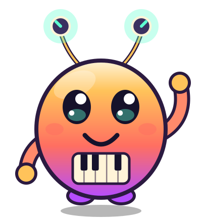

# The Koog Alien



## Who it is

The Koog Alien is Koog's mascot: a round, sunset-colored alien with two antennae that end in little synth knobs and a tiny piano keyboard for a belly. It came from planet Koog to learn Earth music, and it teaches kids to speak **Koogalien**, the language of notes. It is friendly, curious and a little goofy. It hosts the Koogalien module, waves hello, and cheers when a kid earns something.

Character sheet (all poses and moods): `docs/images/koog-alien-sheet.svg`.

## Using the component

```tsx
import { KoogAlien, KoogAlienIcon } from '../brand/mascot/KoogAlien'

<KoogAlien pose="cheer" mood="excited" size={120} animated />
<KoogAlien pose="sing" talking size={200} />      // mouth flaps while it "speaks" Koogalien
<KoogAlienIcon size={24} />                       // one color (currentColor), for 16-32 px
```

| Prop | Values | Default |
|---|---|---|
| `pose` | `wave` `cheer` `think` `sing` `dance` `sleep` `listen` `oops` | `wave` |
| `mood` | `happy` `excited` `curious` `proud` `sad` | `happy` |
| `size` | pixels or any CSS width (height follows) | `160` |
| `animated` | idle bob, antenna glow (about 0.3 Hz), blink, plus a wave/sway/cheer on those poses | `false` |
| `talking` | mouth flap (about 3 Hz) | `false` |
| `labelled` | `false` marks it decorative (`aria-hidden`) | `true` |

The default `aria-label` is like "the Koog Alien, waving". Poses and data live in `src/brand/mascot/alienData.ts` (`POSES`, `MOODS`, `KOOG_ALIEN_COLORS`, `altText()`). The component file exports components only. All motion is inline CSS and stops under `prefers-reduced-motion`. Nothing flashes.

Static files: `public/koog-alien.svg` (default pose), `public/koog-alien-icon.svg` (one color), `docs/images/koog-alien-sheet.svg`. Regenerate them with `npx tsx scripts/mascot-assets.ts`.

## Do and don't

- Do use it to greet, cheer, explain and say "try again, you've got this".
- Do keep it small next to content, never covering what a kid is reading or playing.
- Don't make it scary, angry or creepy. `sad` and `oops` are gentle, never a punishment.
- Don't use it to pressure kids (no "don't leave me", streak guilt or "I'm sad you stopped").
- Don't use it for ads, sponsorship or selling anything.
- Don't add brand logos, real-character look-alikes, or text baked into the art.

## Color tokens

| Token | Hex | Used for |
|---|---|---|
| cream | `#fff4d8` | highlights, belly keys, antenna ring |
| gold | `#ffc35a` | body top, hands, stars, notes |
| coral | `#ff6f61` | body middle, cheeks, tongue |
| purple | `#b44cff` | body bottom, feet |
| arm | `#ff8a6b` | arms |
| navy | `#16122b` | eyes, mouth, black keys |
| plum | `#2b1a40` | outlines |
| knob | `#3a3160` | antenna knob caps |
| mint | `#5fffd0` | knob pointer and glow |

Same family as the Koog logo (`docs/images/koog-banner.svg`) and favicon.
